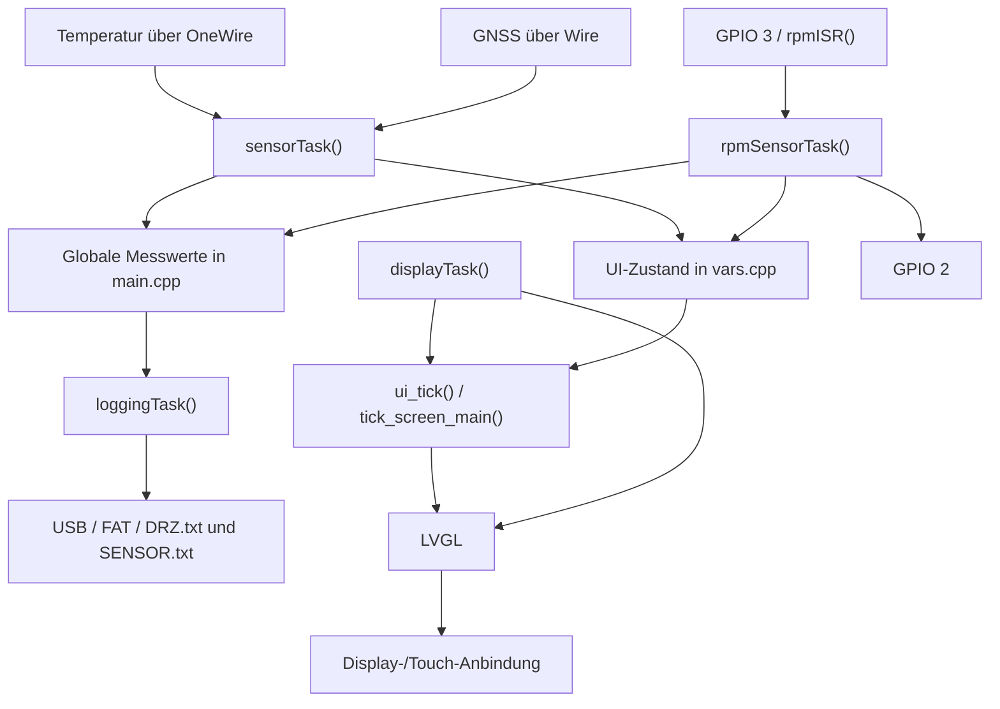

# Technische Übersicht der Firmware

## Grundlage und Geltungsbereich

Diese Übersicht beschreibt den vorhandenen Quelltext, keine geplante Architektur. Grundlage sind die Projektdateien, insbesondere [AGENTS.md](../AGENTS.md), [platformio.ini](../platformio.ini), [src/main.cpp](../src/main.cpp), [src/vars.cpp](../src/vars.cpp) und [mofa.eez-project](../mofa.eez-project) einschließlich der generierten Dateien unter `src/ui`.

Vor der Analyse wurde der aktuelle Git-Branch als `codex/initial-test` geprüft. Es wurden weder ein Build noch eine Hardwareprüfung durchgeführt. Aussagen über das Laufzeitverhalten sind aus dem Code abgeleitet; unklare oder nicht nachgewiesene Eigenschaften sind unten ausdrücklich gekennzeichnet.

Die Zielhardware ist laut `AGENTS.md` der Arduino GIGA R1 M7 mit STM32H747 und Cortex-M7. Das Framework wird dort als Arduino Mbed festgelegt. `platformio.ini` verwendet die Plattform `ststm32`, das Board `giga_r1_m7`, `framework = arduino` und die Build-Umgebung `giga_r1_m7`. Eine eigene Firmware für den zweiten Prozessorkern oder eine Kommunikation mit ihm ist in den untersuchten Anwendungsquellen nicht enthalten.

## 1. Quelldateien und Aufgaben

| Datei oder Verzeichnis | Aufgabe im vorhandenen Projekt |
| --- | --- |
| [src/main.cpp](../src/main.cpp) | Zentraler Anwendungscode: Hardwareobjekte, Konfiguration der Pins und Abfrageraten, Arduino-Einstiegspunkte, Drehzahlinterrupt, vier RTOS-Threads, GNSS-/RTC-Initialisierung und USB-Dateizugriffe. Die Komponenten sind überwiegend Funktionen und globale Zustände dieser Datei. |
| [src/vars.h](../src/vars.h) | Deklariert die Firmware-Helfer `set_ui_velocity()`, `set_ui_temperature()` und `set_ui_time()`. |
| [src/vars.cpp](../src/vars.cpp) | Hält das UI-Datenmodell und Textpuffer, formatiert Messwerte und implementiert die von EEZ erwarteten C-Getter und -Setter. Enthält außerdem die Drehzahlwarnschwelle und die Zeitdarstellung. |
| [src/ui/ui.c](../src/ui/ui.c), [ui.h](../src/ui/ui.h) | Generierter UI-Einstieg mit `ui_init()`, `ui_tick()` und `loadScreen()`. Verwaltet den aktiven Bildschirm. |
| [src/ui/screens.c](../src/ui/screens.c), [screens.h](../src/ui/screens.h) | Erzeugt den einzigen Bildschirm `Main`, hält LVGL-Objektzeiger in `objects_t`, aktualisiert die Widgets über Getter und enthält den Ereignishandler des Drehzahlbogens. |
| [src/ui/vars.h](../src/ui/vars.h) | Generierte Schnittstelle mit sieben UI-Variablen und ihren Getter-/Setter-Deklarationen; von `src/vars.h` zu unterscheiden. |
| [src/ui/images.c](../src/ui/images.c), [images.h](../src/ui/images.h), `src/ui/ui_image_*.c` | Bildtabelle und eingebettete LVGL-Bilddaten für `icon`, `rpm_warning` und `gps`. |
| [src/ui/fonts.h](../src/ui/fonts.h), `src/ui/ui_font_*.c` | Deklarationen und eingebettete Fontdaten für die vier projektspezifischen Schriftgrößen. Die Fonttabelle steht in `screens.c`. |
| [src/ui/actions.h](../src/ui/actions.h), [styles.c](../src/ui/styles.c), [styles.h](../src/ui/styles.h), [structs.h](../src/ui/structs.h) | Generierte Gerüste ohne fachliche Aktionen, globale Style-Funktionen oder Strukturdefinitionen. Die tatsächlich verwendeten Widget-Stile werden direkt in `screens.c` gesetzt. |
| [mofa.eez-project](../mofa.eez-project) | EEZ-Studio-Quelldatei für Layout, Variablen, Assets und Vorlagen zur Erzeugung von `src/ui`. |
| [fonts](../fonts) | Enthält `aurebesh.ttf` und `digital.ttf`. Die aktuell konfigurierten EEZ-Fonts referenzieren `aurebesh.ttf`; eine Nutzung von `digital.ttf` durch diese UI ist nicht belegt. |
| [platformio.ini](../platformio.ini) | Build-Umgebung, Bibliotheksvorgaben, LVGL-Buildflags, serielle Monitorrate und Einbindung lokaler Zusatzkonfigurationen. |

`include`, `lib` und `test` enthalten jeweils nur eine PlatformIO-README. Eigene zusätzliche Header, private Bibliotheken oder implementierte Tests liegen dort nicht vor. Die [Projekt-README](../README.md) beschreibt den Ablauf EEZ-Generierung vor PlatformIO-Kompilierung. Für Uploads gilt unabhängig davon die ausdrückliche Freigabepflicht aus `AGENTS.md`.

`src/ui` ist laut `AGENTS.md` generierter, versionierter EEZ-Code und darf ohne ausdrücklichen Auftrag nicht manuell bearbeitet werden.

## 2. Initialisierung und Hauptprogrammablauf

### Startreihenfolge

`setup()` in [src/main.cpp](../src/main.cpp) führt die folgenden Schritte der Reihe nach aus:

1. `Serial.begin(115200)`, `Wire.begin()` und Einstellung des I²C-Takts auf 400 kHz.
2. Pin 3 als Drehzahleingang mit `INPUT_PULLDOWN`, Pin 2 als Ausgang und Registrierung von `rpmISR()` auf steigende Eingangsflanken.
3. Initialisierung der DallasTemperature-Anbindung mit `sensors_DS.begin()`.
4. `setupGPS()`: Erkennung und Konfiguration des GNSS-Empfängers sowie Versuch, die Systemzeit aus GNSS-Daten zu setzen.
5. `Display.begin()` und `TouchDetector.begin()`, danach `lv_init()`, `lv_tick_set_cb(millis)` und `ui_init()`.
6. Registrierung der USB-Attach-/Detach-Callbacks und einmaliger Aufruf von `msd.connect()` zur Erkennung eines bereits vorhandenen Mediums.
7. Start von `displayThread`, `sensorThread`, `loggingThread` und `rpmSensorThread` mit den zugehörigen Task-Funktionen.

`setupGPS()` wiederholt `gnss.begin(Wire)` mit jeweils einer Sekunde Pause, bis der Aufruf erfolgreich ist. Dafür gibt es kein Endlimit. **Ohne erkannten GNSS-Empfänger werden Displayinitialisierung und Threadstart nicht erreicht.** Anschließend setzt der Code UBX-Ausgabe, `setMeasurementRate(200)` und `setNavigationFrequency(1)`. Eine weitere Schleife prüft bis zu einer verstrichenen Zeit von 5000 ms auf PVT-Daten; bei Erfolg setzt sie über `mktime()` und `set_time()` die Systemzeit. Zusätzliche Blockierzeiten innerhalb der Bibliotheksaufrufe sind aus den Anwendungsquellen nicht bestimmt.

### Laufende Verarbeitung

`loop()` schläft lediglich jeweils zehn Sekunden. Die eigentliche Arbeit erfolgt in Mbed-RTOS-Threads und im Interrupt; `TaskScheduler` wird hierfür im Anwendungscode nicht verwendet.

| Funktion | Aufgabe und zeitliche Steuerung |
| --- | --- |
| `rpmISR()` | Erfasst `micros()` und übernimmt einen neuen Pulszeitpunkt samt Abstand nur, wenn der Abstand größer als 1000 µs ist. Die Übergabe erfolgt über `volatile uint64_t lastPulseTime` und `delta_rpm`. |
| `rpmSensorTask()` | Berechnet die Drehzahl aus dem Pulsabstand mit zwei Pulsen pro Umdrehung, aktualisiert `curRPM` und die UI-Drehzahl und steuert Pin 2. Der Pulsaltervergleich liegt bei 150 ms; bei zu alten Pulsen wird die Drehzahl null. Pro Schleife wird 1 ms geschlafen. |
| `sensorTask()` | Fordert nominell einmal pro Sekunde die Temperatur an und liest Sensorindex 0. Fragt über `gnss.getPVT()` GNSS-Daten ab, aktualisiert Messwerte, UI-Geschwindigkeit, Uhrzeit und GPS-Sichtbarkeitszustand. Schläft nach jedem Durchlauf 10 ms. Der vorgesehene 5-Hz-Serial-Debugblock ist durch `&& false` deaktiviert. |
| `loggingTask()` | Versucht bei erkanntem USB-Medium das Mounten und sammelt danach je eine Drehzahl- und Sensorzeile pro Durchlauf. Schreibt jeweils Blöcke von 20 Zeilen. Schläft nach jedem Durchlauf 100 ms. |
| `displayTask()` | Ruft zuerst `lv_task_handler()`, danach `ui_tick()` auf und schläft für die vom LVGL-Handler zurückgegebene Millisekundenanzahl. |

Die genannten Raten sind aus Konstanten, Zeitvergleichen und Schlafpausen abgeleitet. Sie sind keine nachgewiesenen festen Abtastraten: Bibliotheksaufrufe, Temperaturmessung, Dateizugriffe und Scheduling können zusätzliche Zeit beanspruchen.

### USB-Dateien und Messdaten

`USBHostMSD msd` und `mbed::FATFileSystem fs("usb")` stellen den Massenspeicherzugriff bereit. `usbAttachHandler()` setzt den Erkennungszustand; `usbDetachHandler()` löscht die Zustandsflags und ruft `unmountUSB()` auf. `mountUSB()` versucht die Verbindung und das Mounten bis zu fünfmal.

Bei einem vom Code als erfolgreich bewerteten Mount werden **beide Dateien mit `fopen(..., "w+")` geleert**. `loggingTask()` schreibt anschließend tabulatorgetrennte Kopfzeilen:

- `/usb/DRZ.txt`: Zeitstempel und Drehzahl.
- `/usb/SENSOR.txt`: Zeitstempel, Temperatur, Breite, Länge, Höhe, Geschwindigkeit, Kurs, horizontale Genauigkeit, `gpsOK` und `gpsFix3D`.

Die Zeilen entstehen aus den jeweils zuletzt gespeicherten Messwerten; sie repräsentieren keine gemeinsame neue Sensormessung zum Logzeitpunkt. Die beiden `String`-Puffer werden unabhängig nach jeweils 20 Zeilen mit `fopen(..., "a")`, `fputs()` und `fclose()` angehängt. Ein explizites Schreiben unvollständiger Puffer beim Abziehen ist nicht implementiert. Details und Einschränkungen der Erfolgserkennung stehen in Abschnitt 6.

## 3. Hardware-Schnittstellen und Bibliotheken

### Im Anwendungscode belegte Schnittstellen

| Schnittstelle | Konfiguration und Nutzung |
| --- | --- |
| GPIO 3 | Drehzahlimpulse, `INPUT_PULLDOWN`, Interrupt auf `RISING`. Das konkrete Signal erzeugende Bauteil und die elektrische Eingangsbeschaltung sind nicht dokumentiert. |
| GPIO 2 | Schaltausgang: HIGH bei Drehzahl `> 15000`, LOW bei `< 14500`; dazwischen bleibt der Zustand erhalten. Ein angeschlossener Aktor ist aus dem Code nicht bestimmbar. |
| GPIO 4 / OneWire | `OneWire` und `DallasTemperature`; gelesen wird der Temperatursensor mit Index 0. Sensormodell und tatsächliche Sensoranzahl sind nicht festgelegt. |
| I²C über `Wire` | 400 kHz; `SFE_UBLOX_GNSS` verwendet `gnss.begin(Wire)`. Konkretes Empfängermodell, explizite Geräteadresse und physische I²C-Pins werden im Anwendungscode nicht angegeben. |
| Display und Touch | `Arduino_H7_Video Display(800, 480, GigaDisplayShield)` und `Arduino_GigaDisplayTouch TouchDetector`. Die Anwendung initialisiert beide, definiert aber keine eigenen Display- oder Touch-Pins. |
| USB-Massenspeicher | `Arduino_USBHostMbed5`, `USBHostMSD` und Mbed-FAT-Dateisystem unter `/usb`. |
| Serielle Diagnose | `Serial.begin(115200)`; `monitor_speed = 115200` in PlatformIO. Daraus ergibt sich keine zusätzliche UART-Pinbelegung im Anwendungscode. |
| Systemzeit | GNSS-Übernahme über `mktime()`/`set_time()`, spätere Abfrage über `time()` und `_rtc_localtime()`. Eine eigene Konfiguration der RTC-Hardware ist nicht enthalten. |

Quelle: Hardwaredefinitionen, globale Objekte, `setup()`, `setupGPS()` und Task-Funktionen in [src/main.cpp](../src/main.cpp).

### Explizite PlatformIO-Abhängigkeiten

Die folgenden Angaben sind Versionsvorgaben aus [platformio.ini](../platformio.ini), keine nachgewiesenen installierten Versionsstände:

| Bibliothek | Vorgabe | Nachgewiesene Verwendung |
| --- | --- | --- |
| `arduino-libraries/Arduino_GigaDisplayTouch` | `^1.0.1` | Touchobjekt und Initialisierung in `main.cpp`. |
| `lvgl/lvgl` | `^9.3.0` | GUI-Laufzeit, Widgets, Tick und Ereignisverarbeitung. |
| `arkhipenko/TaskScheduler` | `^3.8.5` | Konfiguriert; keine Einbindung oder Nutzung in den vorhandenen Anwendungsquellen gefunden. |
| `facchinm/Arduino_USBHostMbed5` | `^0.3.1` | USB-Massenspeicher und Erkennungs-/Entfernungs-Callbacks. |
| `sparkfun/SparkFun u-blox GNSS Arduino Library` | `^2.2.28` | GNSS-Konfiguration, PVT-Abfrage und Messwertzugriff. |
| `paulstoffregen/OneWire` | `^2.3.8` | OneWire-Bus an Pin 4. |
| `milesburton/DallasTemperature` | `^4.0.4` | Temperaturanforderung und Auslesen des ersten Sensors. |

Weitere eingebundene APIs sind Arduino, `Wire`, `Arduino_H7_Video`, Mbed-RTOS (`Thread`, `Mutex`, `ThisThread`), `FATFileSystem` und Zeit-/C-Dateifunktionen. `Arduino_H7_Video` steht nicht als eigenständiger Eintrag in `lib_deps`; seine konkrete Auflösung durch Framework oder Abhängigkeiten ist in den eigenen Projektdateien nicht erklärt. Auch die Version der Plattform `ststm32` ist nicht ausdrücklich festgelegt.

`platformio.ini` setzt `lib_archive = false` und die Flags `LV_CONF_SKIP`, `LV_CONF_INCLUDE_SIMPLE` sowie `LV_FONT_MONTSERRAT_20=1`. Eine eigene `lv_conf.h` ist in den untersuchten Projektquellen nicht vorhanden. Lokale Dateien nach dem Muster `platformio.local*.ini` werden zusätzlich eingebunden und von [.gitignore](../.gitignore) ausgeschlossen. Die vorhandene lokale Zusatzkonfiguration setzt `workspace_dir`; ihr lokaler Pfad wird hier nicht übernommen. Die lokale Konfiguration wurde nicht geändert.

## 4. LVGL und EEZ Studio

### Generierung und GUI-Laufzeit

[mofa.eez-project](../mofa.eez-project) konfiguriert ein LVGL-Projekt der EEZ-Projektversion `v3` mit 800 × 480 Pixeln, `colorFormat = BGR`, `lvglVersion = 9.0` und `flowSupport = false`. Das Ausgabeziel ist `src\ui`; Bilder und Fonts werden als C-Quellcode exportiert. `generateSourceCodeForEezFramework` ist deaktiviert. Die tatsächlich vorhandene `ui.c` verwendet direkte LVGL-Aufrufe und keine EEZ-Flow-Runtime.

`ui_init()` erzeugt über `create_screens()` das LVGL-Standardtheme und den Bildschirm `Main`. Anschließend lädt `loadScreen(SCREEN_ID_MAIN)` diesen mit einer 200-ms-Fade-in-Animation. `ui_tick()` delegiert an `tick_screen(currentScreen)` und damit an `tick_screen_main()`. Diese Funktion vergleicht die UI-Variablen mit den aktuellen Widgetwerten und ändert Texte, Drehzahlbogen oder Sichtbarkeit nur bei abweichenden Werten.

Die Firmware setzt `millis` als LVGL-Tickquelle. Ihre laufende GUI-Verarbeitung erfolgt im Displaythread. Eigene Flush-Callbacks, Renderpuffer oder eine LVGL-Eingabegeräteregistrierung sind in den Anwendungsquellen nicht vorhanden. Welche Registrierung die Display-/Touch-Bibliotheken übernehmen und wie sich die Reihenfolge `Display.begin()` vor `lv_init()` auswirkt, lässt sich daraus nicht vollständig ableiten.

### Datenanbindung und Widgets

Die generierte [src/ui/vars.h](../src/ui/vars.h) deklariert C-Getter und -Setter. [src/vars.cpp](../src/vars.cpp) implementiert diese mit `extern "C"` und ergänzt die Formatierungshelfer aus `src/vars.h`. Die EEZ-Projektdatei führt die Variablen mit `native = false`; der vorhandene generierte Code bindet sie dennoch konkret über diese Funktionen an.

| Variable oder Helfer | Darstellung und vorhandene Semantik |
| --- | --- |
| `motor_rpm`, `motor_rpm_text` | Drehzahlbogen im Bereich 0 bis 20000 und numerisches Label. `set_var_motor_rpm()` begrenzt den gespeicherten Wert nach oben auf 999999 und formatiert mindestens fünf Stellen. |
| `hide_rpm_warning` | Steuert `LV_OBJ_FLAG_HIDDEN` des Warnbilds. `set_var_motor_rpm()` blendet die Warnung ab 15000 ein. Diese Schwelle besitzt keine Hysterese und unterscheidet sich vom GPIO-Schaltverhalten. |
| `set_ui_velocity()` / `velocity_text` | Ganzzahliger Geschwindigkeitstext, nach oben auf 9999 begrenzt; das Layout zeigt `km / h`. |
| `set_ui_temperature()` / `temperature_text` | Eine Nachkommastelle; bei Werten `<= -120` der Text `000`. Das Layout zeigt `° C`. |
| `set_ui_time()` / `time_text` | `HH:MM:SS`, wobei pauschal zwei Stunden addiert und modulo 24 gerechnet werden. |
| `gps_online` | Der Setter speichert `!value`; der Getter steuert unmittelbar das Hidden-Flag des GPS-Symbols. Ein Aufruf mit `true` macht das Symbol deshalb sichtbar. Der gespeicherte Wert bezeichnet faktisch das Verbergen des Symbols. |

Die Setter für die Textvariablen und `hide_rpm_warning` sind leere Funktionen. Der Anwendungscode schreibt diese Zustände über die Formatierungshelfer beziehungsweise `set_var_motor_rpm()`. Der Drehzahlbogen besitzt außerdem einen `LV_EVENT_VALUE_CHANGED`-Handler, der `set_var_motor_rpm()` aufruft. `tick_value_change_obj` verhindert dabei Rückkopplungen durch programmgesteuerte Aktualisierungen. Eigene EEZ-Aktionen sind nicht definiert.

Vier generierte Fonts (`DIGITAL_72`, `DIGITAL_128`, `DIGITA_32`, `DIGITAL_92`) basieren laut EEZ-Konfiguration und Dateiköpfen auf `fonts/aurebesh.ttf`. Zusätzlich verwendet `screens.c` Montserrat 14 und 20; Montserrat 20 wird ausdrücklich im Buildflag aktiviert. Die Bilder `icon` (64 × 64), `rpm_warning` (96 × 96) und `gps` (32 × 32) liegen als eingebettete `RGB565A8`-Daten in den jeweiligen `ui_image_*.c` vor. Die GUI lädt diese Assets im vorhandenen Code nicht von USB nach.

## 5. Abhängigkeiten und Datenfluss

- **Hardware und Ablauf:** `main.cpp` erzeugt die Hardwareobjekte und RTOS-Threads. Eine Trennung in eigene Sensor-, Logger- oder Treiberklassen besteht im Anwendungscode nicht.
- **Zwei Zustandsbereiche:** Die `cur*`-Variablen in `main.cpp` versorgen das Logging; die Zustände und Textpuffer in `vars.cpp` versorgen die UI. Sensor- und Drehzahlthread aktualisieren beide Bereiche. Die Anzeige liest nicht direkt aus den Logpuffern.
- **Synchronisierung:** `dataMutex` schützt viele Zugriffe auf die globalen Messwerte, unter anderem das Zusammenstellen von Logzeilen. Der Drehzahlthread schreibt `curRPM` jedoch ohne diese Sperre. Auch die UI-Getter, -Setter und Textpuffer verwenden keine sichtbare Synchronisierung zwischen Sensor-/Drehzahlthread und Displaythread. Ein durchgängig konsistenter Snapshot aller Werte ist damit im Projektcode nicht abgesichert.
- **Interruptgrenze:** Der Drehzahlthread liest die vom Interrupt geschriebenen `volatile uint64_t`-Werte ohne sichtbare gemeinsame Momentaufnahme oder Interruptsperre. Eine atomare, zusammengehörige Übergabe ist aus diesen Quellen nicht belegt.
- **Generierungsabhängigkeit:** EEZ-Variablennamen und generierte Deklarationen müssen zu den Implementierungen in `vars.cpp` passen. `screens.c` benötigt außerdem LVGL, die generierten Bild-/Fontsymbole und die von `ui.c` verwaltete Bildschirmstruktur. `setup()` muss die GUI erzeugen, bevor `displayTask()` sie regelmäßig aktualisiert.
- **Startabhängigkeit:** Die GNSS-Erkennung liegt vor Display- und USB-Initialisierung. Die Systemzeit für Anzeige und Logdateien wird beim Start aus GNSS übernommen; eine erneute laufende Synchronisierung ist im Code nicht enthalten.

## 6. Unklarheiten und erkennbare Einschränkungen

Die folgenden Punkte sind aus dem Quelltext erkennbar. Ihre Auswirkungen wurden in diesem Auftrag weder durch einen Build noch auf Hardware geprüft.

| Bereich | Beleg und Grenze der Aussage |
| --- | --- |
| Display-/Touch-Anbindung und Versionen | EEZ ist auf LVGL `9.0` eingestellt, PlatformIO fordert `^9.3.0`. Eine Inkompatibilität ist dadurch allein nicht nachgewiesen. Konkrete Treiberregistrierung, effektiv verwendete Bibliotheksversionen und Initialisierungsverhalten wurden nicht durch Frameworkanalyse oder Build bestätigt. |
| GNSS-Rate und Status | `setupGPS()` setzt sowohl eine Messperiode von 200 ms als auch `setNavigationFrequency(1)`. Die daraus wirksame Rate ist aus der Anwendung allein unklar. `gpsOK` bleibt nach erfolgreicher Initialisierung wahr; `gpsFix3D` folgt dem letzten PVT-Datensatz. Der sichtbare GPS-Status folgt dagegen dem Erfolg der jeweiligen `getPVT()`-Abfrage, nicht unmittelbar einem 3D-Fix. |
| GNSS-Einheiten | Breite, Länge und Kurs werden ohne Skalierung aus den Gettern übernommen, obwohl die Logspalten Grad benennen. Höhe wird beim Logging mit `0.001`, Geschwindigkeit für UI und Logging mit `0.0036` und horizontale Genauigkeit beim Einlesen mit `1/1000` umgerechnet. Die nativen Getter-Einheiten sind durch den eigenen Anwendungscode nicht gesichert. Der Name `curSpeedMps` sowie der Header `Acc_ms-1` passen nicht eindeutig zu diesen Umrechnungen beziehungsweise `curAccM`. |
| Zeitbasis | Die Logheader lauten `Time_UTC`, die Zeitstempel entstehen jedoch über `_rtc_localtime()`. Die UI addiert zusätzlich fest zwei Stunden; eine Sommer-/Winterzeitregel ist nicht implementiert. Die lokale Zeitbasis ist aus der Anwendung nicht eindeutig festgelegt. `setupGPS()` initialisiert `struct tm tGPS` nicht vollständig und prüft keine ausdrücklichen GNSS-Zeitgültigkeitsflags. |
| Drehzahlzustand | `lastPulseTimeSaved` wird in `rpmSensorTask()` mit null initialisiert, aber nie aktualisiert. Der Vergleich erkennt damit nach dem ersten übernommenen Puls keine neuen Pulse im Sinne eines gespeicherten letzten Zustands. Die Berechnung kann stattdessen in jedem Durchlauf erneut erfolgen; der Pulsaltervergleich bleibt vorhanden. `RPM_PULSE_PER_REV` und `RPM_MIN_VALID` sind definiert, werden aber nicht verwendet; der Faktor zwei steht direkt im Berechnungsaufruf. |
| USB-Erfolgserkennung und Fehler | `mountUSB()` überschreibt den Rückgabewert von `fs.mount()` unmittelbar mit `errno` und bewertet danach diesen Wert. Nach dem Mountversuch schreibt der Logger ohne erneute Prüfung von `usbMountedFlag`. Schreibfehler werden nicht an den Logger zurückgegeben; dessen Pufferzähler werden nach dem Schreibversuch zurückgesetzt. Eine gesicherte Speicherung ist daraus nicht abzuleiten. |
| USB-Abziehen und Restpuffer | Zwischen Unmount im Callback und Schreiben im Logger ist keine gemeinsame Sperre sichtbar. Unvollständige Puffer werden beim Abziehen weder explizit geschrieben noch zurückgesetzt. Beim nächsten als erfolgreich bewerteten Mount werden die Dateien geleert. Aussagen wie „verlustfrei“ oder „sicheres Entfernen“ sind daher trotz entsprechender Kommentare nicht nachgewiesen. |
| Temperatur und reale Hardware | `tempOK` prüft `-55 < tC < 125`, verhindert aber weder die Anzeige noch das Logging des Wertes. Konkrete Sensor-/GNSS-Modelle, elektrische Beschaltung und tatsächlich angeschlossene Geräte sind aus den Projektdateien nicht bestimmbar. |

Belegstellen für diese Grenzen sind insbesondere `setupGPS()`, `mountUSB()`, `safeFileWrite()`, `sensorTask()`, `loggingTask()` und `rpmSensorTask()` in [src/main.cpp](../src/main.cpp), die Formatierungs- und Getter-/Setter-Funktionen in [src/vars.cpp](../src/vars.cpp) sowie die Bindungen in [src/ui/screens.c](../src/ui/screens.c).
