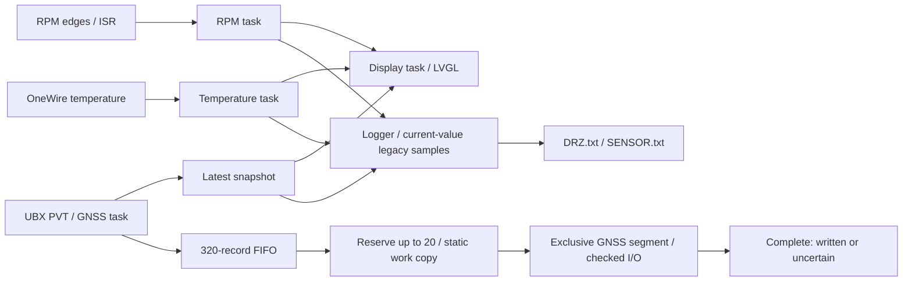

# Firmware architecture

Maintenance baseline: `e025292`, branch `feature/gnss-fifo-logging`, STEP 230.
This is a source description, not a claim of hardware validation or an official
release version. The existing tracked filename is `architecture.md`; Windows
also resolves the requested `ARCHITECTURE.md` to this file.

## Hardware and execution

Arduino GIGA R1 uses the STM32H747 Cortex-M7 under Arduino Mbed/RTX. The project
builds the M7 environment `giga_r1_m7`; it does not implement an M4 application.
The GIGA Display Shield is exposed as an 800x480 logical LVGL display. The DSI
framebuffer dimensions are obtained at runtime rather than inferred from the
logical orientation. GigaDisplayTouch supplies touch input through its library.

| Connection | Current source contract |
| --- | --- |
| RPM input | Pin 3, pulldown, rising edge, two pulses/revolution |
| RPM warning output | Pin 2, HIGH for active over-rev warning |
| Temperature | OneWire pin 4, DallasTemperature sensor index 0 |
| GNSS | u-blox UBX NAV-PVT over Wire, address 0x42, 400 kHz bus |
| Storage | USB host mass storage, FAT volume named `/usb` |
| Serial | 115200 baud, project diagnostic levels described below |

Electrical conditioning, sensor calibration and safe voltage levels must be
verified against the actual installation; firmware pin declarations are not an
electrical design specification.

## Startup and ownership

`setup()` starts Serial and Wire, installs the RPM ISR, initializes temperature,
then starts video and installs the project flush callback on successful video
initialization. Touch is initialized and LVGL uses `millis()` as its tick source.
UI placeholders and `ui_init()` run before application display-thread access.
USB callbacks are registered before the logger starts. Heap observation is
initialized after UI/peripheral setup, then display, temperature, logger, RPM
and GNSS tasks are started. The Arduino `loop()` only sleeps for ten seconds.
Receiver discovery is asynchronous; `[READY]` means task dispatch was attempted,
not that GNSS has a fix, a USB stick is mounted or every task start was verified.
Only GNSS task-start failure is currently checked explicitly. Display init and
callback registration failures now receive serial status without changing the
existing continuation behavior.

| Owner | Priority / stack | Timing and responsibility |
| --- | --- | --- |
| RPM ISR | Interrupt context | Copy wrapping microsecond time/delta, reject intervals <=1000 us; no RTOS lock, allocation or serial |
| RPM task | Mbed default Normal / default stack | 1 ms sleep; copy ISR pair in a short interrupt-masked section, calculate raw RPM, drive warning and publish |
| Temperature task | Mbed default Normal / default stack | Nominal 1 Hz conversion/read, 10 ms loop sleep; blocking conversion may extend the interval |
| GNSS task | Normal / 4096-byte static stack | 10 ms receive loop, 250 ms command timeout, independent connection/retry state |
| Logger | Mbed default Normal / default stack | 100 ms sleep after work; all connect/mount/unmount/FILE operations and legacy samples |
| Display | Normal / 8192 bytes | UI, smoothing, startup sweep, LVGL handler, diagnostics and ui_tick; sleep clamped to 2..20 ms |

Unspecified task stacks use the installed Mbed default (4096 bytes in the
validated configuration). Library-owned USB/tick/event threads also execute;
the application does not control their scheduling. Timing constants are not
measured deadlines: USB, I2C, temperature conversion, rendering and scheduling
can delay a round. The 8 KiB display stack preserves existing headroom for LVGL
synchronous drawing; remeasure watermarks after changing EEZ styles/widgets.

`dataMutex` protects the RPM/warning pair and temperature. The GNSS snapshot
mutex protects a latest-value copy; a separate FIFO mutex protects only record
copies, indices and accounting. These locks are never nested. No filesystem,
serial, allocation or formatting work is allowed under the FIFO mutex. Only
the display thread accesses LVGL/model strings after setup. USB callbacks publish
lock-free atomic attachment and detach-generation events, never filesystem work.
These atomic fields are individual observations, not a coherent multiword snapshot.

## Data flow

The graph represents copies, not transfer of object ownership. Legacy logs are
current-value nominal 10 Hz sampling; they do not reconstruct historical GNSS
epochs. GNSS logs preserve accepted epochs even without position/time validity.

## GNSS acquisition and time

`gnss_service.cpp` exclusively owns SparkFun receiver/library state. It enables
UBX on I2C, disables auto PVT while configuring 200 ms measurement and navigation
rate 1, verifies fresh CFG-RATE, then enables auto PVT. Calling a 1 Hz navigation
frequency setter would overwrite the required measurement period and is avoided.
`EpochTracker` rejects duplicate, old and implausible packets; `RateMonitor`
requires three regular 200 ms steps before session publication. A persistent
rate mismatch, two failed periodic rate checks (10 s apart), or 1500 ms without
fresh epochs causes invalidation and reconnect. Retry pauses increase 1/2/4/8 s.
The tracker retains its high-water mark across sessions and can re-anchor after
three plausible regular rejected steps; a newly trusted UTC anchor starts a
fresh baseline rather than publishing a provisional transition.

A snapshot exposes connection, session/sample, host receipt time, raw epoch
spacing, SI presentation values and independent validity flags. Position needs
a valid 2D/3D/combined fix; altitude additionally excludes a 2D fix. UTC calendar
conversion rejects invalid/unresolved time, leap seconds and years outside
2000..2099, and normalizes fractional nanoseconds. RTC is set once per boot,
rounded to the nearest second. Reconnect never steps it. UI uses RTC holdover
and explicit CET/CEST conversion; stored timestamps remain UTC. The legacy
`log_clock::Clock` anchors once to GNSS and accumulates unsigned host elapsed
time thereafter. Before sync it exposes calendar-shaped uptime, not trusted UTC.

## RPM, temperature and UI

RPM is `60e6 / (delta_us * 2)`. The first pulse after start/timeout supplies a
reference only. After 150000 us without a pulse, RPM/warning return to zero.
Hysteresis asserts above 15000 RPM and clears below 14500. This raw warning
drives pin 2 independently of display smoothing. `RpmDisplayFilter` has adaptive
deadband/time constant and rounding hysteresis, and belongs only to the UI.
Temperature is read through DallasTemperature; the -127 C missing-sensor value
is rendered unavailable. Legacy formatting retains its existing sentinel rules.

`vars.cpp` implements EEZ bindings with static strings/visibility flags. Generated
text setters intentionally do nothing. `set_var_gps_online` stores inverse
visibility, so its backing boolean must not be read as a direct validity flag.
A three-second one-shot UI self-test exercises display elements; a real RPM
warning cancels it. UI edits originate in `mofa.eez-project` and must regenerate
`src/ui`; generated assets were reviewed as generated interfaces and not edited.

## Display mapping and DMA lifetime

`display_rotation.cpp` replaces the registered library callback using LVGL's
public setter. It accepts partial RGB565 buffers only, checks source extent,
stride, integer overflow and framebuffer bounds, then uses public
`lv_display_rotate_area` mapping. At 180/270 degrees the public offset getters
report physical dimensions even for zero raw translation; equality against the
rotated physical getters recognizes this. Nonzero raw offsets are rejected.

The checked plan uses two bytes/pixel. DMA2D InputOffset=0 requires tight output
rows. `Buffer::ensure` commits a realloc result only on success; failed growth
retains the previous pointer/capacity. Even zero rotation copies into project-owned
storage. LVGL buffers are never lent to DMA. The scratch buffer persists for boot
and is reused; no per-frame free is needed. The current typical 800x24 rotated
block requires 38400 bytes, not four bytes/pixel. Actual capacity follows the
largest accepted plan; heap availability remains a runtime constraint.

DMA checks inactive state before start, HAL initialization/layer/start status,
and poll completion (25 ms timeout). On timeout/error it attempts abort and
requires both successful abort and hardware inactivity. Any uncertain ownership
pins the buffer until reboot: no subsequent write, growth or transfer is allowed.
Every flush outcome signals `lv_display_flush_ready` exactly once; this releases
LVGL's own buffer without releasing the quarantined project buffer. Cache
maintenance/barriers and DSI framebuffer stability are hardware assumptions.
`[F_DISPLAY_PINNED]` reports quarantine once outside flush at every level.
Successful checked transfer does not prove correct visible pixels.

## USB registration, recovery and checked writes

`usb_mount_state.h` separates registered, usable and cleanup-pending state. A
mount attempt may register FAT resources before failing. The logger marks the
attempt before calling FAT, then permits writes only after successful mount
with unchanged attachment/generation. Cleanup is retried at one-second intervals;
remount is blocked until registration is released. Successful unmount or the
installed FAT already-unregistered `-EINVAL` result clears registration. Other
errors leave cleanup pending. Rapid detach/re-attach is detected by generation,
not attachment alone. All FILE cleanup returns before application unmount.

`FileOps` captures errno immediately and checks open, complete fwrite byte count,
ferror, fflush and fclose. It never examines a FILE after close. First-failure
context survives later cleanup errors. A stream failure or generation change
prevents confirmation. Application serialization does not protect the driver's
internal device pointer from its independent detach thread; accepted library
risks remain in [KNOWN_ISSUES.md](KNOWN_ISSUES.md).

## FIFO, segments and accounting

A `GnssLogRecord` is exactly 64 bytes in original UBX fixed-point units. The 320
usable entries occupy 20480 bytes and cover 64 seconds of 5 Hz input when empty.
The single GNSS producer increments accepted/sequence even on Drop-newest
loss. Reconnects preserve FIFO, counters and sequence. The single logger reserves
at most 20 entries into a separate 1280-byte static work copy. Reserved entries
remain queued and cannot be overwritten; the producer never waits for USB I/O.
Full blocks are due immediately; partial blocks wait one second from the oldest
record. Modular age ordering requires elapsed times below 2^31 ms. Completion
must match sequence and reserved count exactly. Success moves the block to
written; any attempted failed block moves entirely to uncertain and is never
replayed. Unattempted records remain queued. The invariant is:

`accepted = written + queued + overflow + uncertain`

Segment names `/usb/GN000000.tsv` through `GN009999.tsv` use O_EXCL, 32 attempts
per round and 10000 candidates per boot. Existing files are never truncated.
The boot cursor never revisits a name, including after failures. Missing/exhausted
GNSS segments retain the FIFO and do not prevent legacy work. A GNSS-specific
I/O failure retires the segment; shared recovery still responds to medium changes,
checked legacy failures or invalid FIFO completion. Attempted legacy blocks are
also not replayed; their separate `legacyUncertain` is not part of the FIFO identity.

`DRZ.txt` keeps two columns; `SENSOR.txt` keeps ten. `# GNSS_LOG_V1` keeps its
17-column schema and validity-dependent empty fields. `# STATS` records keep
boot-wide counters, highWater, legacyUncertain and segment-search progress.
Statistics remain formatted/checked and persisted every second/on new segment
at all diagnostic levels. Only the serial copy is gated at LOGGER level 2.
Checked close/flush does not establish power-fail durability or exactly-once storage.

## Diagnostics and memory

`diagnostics_config.h` defaults `MOFA_DEBUG_LEVEL` to 0. Each of GNSS, RPM,
DISPLAY, USB, LOGGER, MEMORY and RTOS inherits it unless `MOFA_DEBUG_<NAME>`
is explicitly defined. Values outside 0..4 are compile errors. Overrides replace,
rather than take the maximum with, the global level. `MOFA_DIAG` takes statements
inside a constant conditional: disabled arguments are not evaluated. Formatting
functions with private buffers additionally use preprocessing gates. The optimized
firmware's BIN is inspected to verify string removal; macros alone are not proof.

Call sites use reserved project selectors, for example
`MOFA_DIAG(MOFA_SUBSYS_DISPLAY, 3, Serial.println("display detail"));`.
Each `MOFA_SUBSYS_*` expands directly to the corresponding numeric `MOFA_DEBUG_*`
level. No forwarded token concatenation occurs: a library macro such as
`DISPLAY=0x1` cannot change the selector. The collision regression defines all
seven generic subsystem words and proves enabled/disabled behavior at compile time.

| Level | Serial policy |
| --- | --- |
| 0 RELEASE | `[BOOT]` baseline/build date/time, `[READY]` dispatch status; display init/callback/quarantine failures, GNSS thread-start failure, FIFO completion invariant failure |
| 1 ERROR | Above plus recoverable GNSS/logger errors, globally throttled USB error summary, display error summary, allocation-failure summary |
| 2 INFO | Above plus USB mounted transition, GNSS CFG-RATE values, serial `# STATS` |
| 3 DEBUG | GNSS ten-second rate windows, USB first-failure detail, heap history/allocation detail, first display parameters/transfer evidence; RTOS stack markers |
| 4 TRACE | Above plus LOGGER operation before/after markers (first six, then one sample/5 s); usable independently of RTOS override |

RPM currently has no serial instrumentation; its override is reserved and does
not introduce work in the ISR. RTOS level 3 enables the existing logger stack
marker sampling; LOGGER level 4 also enables it. USB detailed reports share a
five-second global budget independent of filename. Counters are updated before
that budget and before verbosity gates; class counts have eight-class retention,
while global suppressed totals saturate and survive eviction. Display counters,
heap capture/rings and all error detection remain active in RELEASE. These are
application/evidence counters, not statements that were actually printed.

Serial calls have fixed strings or bounded buffers (USB/heap 384 bytes, GNSS
192 bytes, display 256 bytes, logger 160 bytes); no diagnostic heap allocation
is introduced. Histories/rings and startup bursts are bounded. Output never occurs
in the RPM ISR, USB callbacks, allocator trace callback or display flush. Higher
levels may still block in Serial.write/print; the core cannot guarantee UART
nonblocking behavior. There is no wait-for-monitor loop. The USB observer and heap APIs preserve errno with scoped guards; display flush
and reportErrors save/restore it explicitly. Standalone MOFA_DIAG serial calls
(including startup and GNSS messages) do not universally preserve errno.
Output runs outside application mutex regions. Reducing
serial output is not proof of reduced runtime heap use or improved deadlines.

Static FIFO/work/format arrays total 22144 bytes before metadata and mutexes.
Legacy Arduino String arrays, FAT resources, video and rotation storage use heap.
Heap observer histories and failure counters remain active when printing is off.
Mbed allocation callback records a fixed ring only; the logger drains it after
cleanup. Captured deltas are system-wide concurrent observations, not proof of
which subsystem allocated memory. Linker `.heap` is an address reservation,
not measured free memory; PlatformIO RAM accounting excludes separate RAM-D2
`.lwip_sec`. Stack/heap/runtime measurements require the target board.

## Build, tests and release preparation

See [README](../README.md) for exact commands and flag examples,
[KNOWN_ISSUES](KNOWN_ISSUES.md) for acceptance and verification gaps, and
[STEP230_VALIDATION](STEP230_VALIDATION.md) for measured build results.
`platformio.ini` remains the dependency/build authority; local overrides are not
modified by this step. The existing runner resolves all mutable PlatformIO paths
under `.pio/gnss-fifo-p3`. Host constexpr policies, executable fault scenarios,
source contracts and binary string checks cover different layers; none emulates
RTX/USB/DSI hardware. Independent CASE review and explicit merge/upload approval
remain required before a release is promoted.
