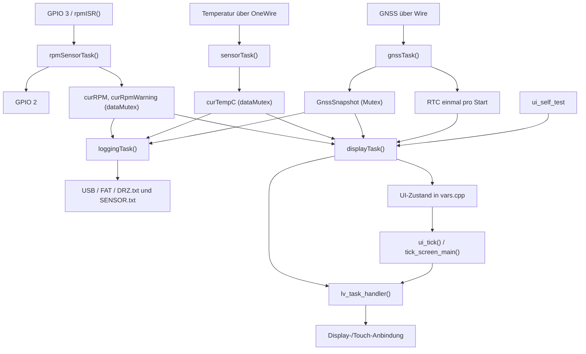

# Technische Übersicht der Firmware

## Grundlage und Geltungsbereich

Diese Übersicht beschreibt den Quelltext im Repository, keine geplante Architektur. Grundlage sind die Projektdateien, insbesondere [AGENTS.md](../AGENTS.md), [platformio.ini](../platformio.ini), [src/main.cpp](../src/main.cpp), [src/gnss_service.cpp](../src/gnss_service.cpp), [src/vars.cpp](../src/vars.cpp) und [mofa.eez-project](../mofa.eez-project) einschließlich der generierten Dateien unter `src/ui`.

Prüfstand dieser Fassung:

- **Build:** `pio run -e giga_r1_m7` läuft fehlerfrei durch (Flash 60,6 % von 786 432 Byte, RAM 24,6 %).
- **Richtlinientests:** Die vier Dateien unter `test/` werden vom Compiler ausgewertet (siehe Abschnitt 1) und bestehen. Ein Build führt sie nicht aus.
- **Hardware:** Gemessen wurden nur die Stackspitzen der Threads auf dem Board (Abschnitt 2). Während dieser Messung lieferte der GNSS-Empfänger keine Epochen. Alle anderen Aussagen über das Laufzeitverhalten sind aus dem Code abgeleitet; unklare oder nicht nachgewiesene Eigenschaften sind ausdrücklich gekennzeichnet.

Die Zielhardware ist laut `AGENTS.md` der Arduino GIGA R1 M7 mit STM32H747 und Cortex-M7. Das Framework ist Arduino Mbed; `platformio.ini` verwendet die Plattform `ststm32`, das Board `giga_r1_m7`, `framework = arduino` und die Build-Umgebung `giga_r1_m7`. Eine Firmware für den zweiten Prozessorkern oder eine Kommunikation mit ihm ist nicht enthalten.

## 1. Quelldateien und Aufgaben

| Datei oder Verzeichnis | Aufgabe |
| --- | --- |
| [src/main.cpp](../src/main.cpp) | Hardwareobjekte, Konfiguration, Arduino-Einstiegspunkte, Drehzahlinterrupt, die RTOS-Threads für Drehzahl, Temperatur, Logging und Display sowie USB-Mount und Dateizugriffe. Der GNSS-Thread wird aus `setup()` gestartet, liegt aber in `gnss_service.cpp`. |
| [src/gnss_service.h](../src/gnss_service.h), [gnss_service.cpp](../src/gnss_service.cpp) | Eigener GNSS-Thread (`gnssThread`, statischer 4-KiB-Stack). Konfiguriert den Empfänger, liest PVT-Epochen, prüft Reihenfolge und Rate, setzt einmal pro Start die RTC und veröffentlicht den jeweils letzten Stand als `GnssSnapshot`. `readGnssSnapshot()` liefert eine Kopie und markiert Daten nach 1,5 s ohne neue Epoche als veraltet. |
| [src/gnss_epoch.h](../src/gnss_epoch.h) | Reine Richtlinienlogik ohne Hardwarebezug: `EpochTracker` (Reihenfolge, Duplikate, Zeitsprünge, neue Basis nach drei regelmäßigen Schritten eines abgelehnten Stroms) und `RateMonitor` (Abstand der Epochen gegen 200 ms). |
| [src/rpm_display_filter.h](../src/rpm_display_filter.h) | Glättung der angezeigten Drehzahl mit Totzone und Hysterese. Wirkt nur auf die Anzeige; Rohdrehzahl, Logging und Warnausgang nutzen sie nicht. |
| [src/ui_self_test.h](../src/ui_self_test.h) | Startdurchlauf von 3 s: schiebt Drehzahl, Geschwindigkeit, Temperatur, Warnsymbol, Uhr und alle GPS-Statustexte durch ihren Wertebereich. |
| [src/local_time.h](../src/local_time.h) | Umrechnung UTC in Wanduhrzeit: UTC+1 (MEZ) beziehungsweise UTC+2 (MESZ) nach der EU-Regel (letzter Sonntag im März/Oktober, 01:00 UTC). |
| [src/log_clock.h](../src/log_clock.h) | Eine monoton laufende Uhr für die Logzeitstempel, einmalig auf die erste gültige GNSS-Zeit verankert. |
| [src/vars.h](../src/vars.h), [vars.cpp](../src/vars.cpp) | UI-Datenmodell und Textpuffer. Helfer: `set_ui_velocity()`, `set_ui_temperature()`, `set_ui_time(int64_t utcSeconds)`, `set_ui_time_unavailable()`, `set_ui_rpm_warning()`, `set_ui_gps_status()`, `set_ui_self_test()`. Implementiert zudem die von EEZ erwarteten C-Getter und -Setter. |
| [src/ui/ui.c](../src/ui/ui.c), [ui.h](../src/ui/ui.h) | Generierter UI-Einstieg mit `ui_init()`, `ui_tick()` und `loadScreen()`. |
| [src/ui/screens.c](../src/ui/screens.c), [screens.h](../src/ui/screens.h) | Erzeugt den einzigen Bildschirm `Main`, hält LVGL-Objektzeiger in `objects_t` und aktualisiert die Widgets über Getter. |
| [src/ui/vars.h](../src/ui/vars.h) | Generierte Schnittstelle mit elf UI-Variablen; von `src/vars.h` zu unterscheiden. |
| [src/ui/images.c](../src/ui/images.c), [images.h](../src/ui/images.h), `src/ui/ui_image_*.c` | Bildtabelle und eingebettete LVGL-Bilddaten für `icon`, `rpm_warning` und `gps`. |
| [src/ui/fonts.h](../src/ui/fonts.h), `src/ui/ui_font_*.c` | Eingebettete Fontdaten für die vier projektspezifischen Schriftgrößen. |
| [src/ui/actions.h](../src/ui/actions.h), [styles.c](../src/ui/styles.c), [styles.h](../src/ui/styles.h), [structs.h](../src/ui/structs.h) | Generierte Gerüste ohne fachliche Inhalte. Die verwendeten Widget-Stile stehen direkt in `screens.c`. |
| [mofa.eez-project](../mofa.eez-project) | EEZ-Studio-Quelldatei für Layout, Variablen, Fonts und Assets; Quelle für `src/ui`. |
| [fonts](../fonts) | `aurebesh.ttf` und `digital.ttf`. Die konfigurierten EEZ-Fonts verwenden `aurebesh.ttf`; `digital.ttf` wird von dieser UI nicht genutzt. |
| [test](../test) | Vier Compile-only-Tests (`gnss_epoch`, `ui_self_test`, `local_time`, `log_clock`): `static_assert` auf `constexpr`-Funktionen der Richtlinien-Header. Aufruf von Hand, zum Beispiel `g++ -std=c++17 -fsyntax-only test/log_clock/*.cpp`. `pio run` und der einzige Build-Env übersetzen `test/` nicht. `include` und `lib` enthalten nur die PlatformIO-README. |
| [platformio.ini](../platformio.ini) | Build-Umgebung, Bibliotheksvorgaben, LVGL-Buildflags, Monitorrate und Einbindung lokaler Zusatzkonfigurationen. |

Die [Projekt-README](../README.md) beschreibt den Ablauf EEZ-Generierung vor PlatformIO-Kompilierung. Für Uploads gilt unabhängig davon die ausdrückliche Freigabepflicht aus `AGENTS.md`. `src/ui` ist generierter, versionierter EEZ-Code und wird nur über EEZ Studio geändert.

## 2. Initialisierung und Hauptprogrammablauf

### Startreihenfolge

`setup()` in [src/main.cpp](../src/main.cpp) führt der Reihe nach aus:

1. `Serial.begin(115200)`, `Wire.begin()` und I²C-Takt 400 kHz.
2. Pin 3 als Drehzahleingang mit `INPUT_PULLDOWN`, Pin 2 als Ausgang, `rpmISR()` auf steigende Flanken.
3. `sensors_DS.begin()` für den OneWire-Temperatursensor.
4. `Display.begin()` und `TouchDetector.begin()`, danach `lv_init()` und `lv_tick_set_cb(millis)`.
5. Anfangszustand der UI (`set_var_gps_online(false)`, `set_ui_velocity(-1)`, `set_ui_time_unavailable()`) und `ui_init()`.
6. USB-Callbacks registrieren und einmal `msd.connect()` aufrufen.
7. Threads starten: `displayThread`, `sensorThread`, `loggingThread`, `rpmSensorThread`, zuletzt `startGnss()`.

Der GNSS-Empfänger blockiert den Start nicht mehr. Fehlt er, wiederholt der GNSS-Thread die Verbindung mit wachsender Pause (1 s, 2 s, 4 s, höchstens 8 s); Display, Drehzahl, Temperatur und Logging laufen weiter, und die UI zeigt „GPS: searching“ beziehungsweise (antwortet das Modul nicht am I²C) „GPS: no module“ in Rot. Schlägt der Start des GNSS-Threads selbst fehl, meldet die UI „GPS: thread error“.

`Display.begin()` kommt aus der Bibliothek `Arduino_H7_Video`. Deren Symbole enthalten den LVGL-Flush-Callback (`lvgl_displayFlushing`), den Touch-Callback (`_lvglTouchCb`) und einen eigenen Tick-Thread. Ob der anschließende Aufruf von `lv_init()` in `setup()` dadurch überflüssig ist, wurde nicht geprüft.

### Threads und Stacks

`loop()` schläft lediglich jeweils zehn Sekunden. Die Arbeit erfolgt in Mbed-RTOS-Threads und im Interrupt. Die Stackspitzen stammen aus einer Messung auf dem Board über die RTX-Wasserzeichen (Selbsttest und laufende UI, einige Dutzend Sekunden); sie sind Momentaufnahmen, keine Garantien. Der Messcode ist nicht im Repository.

| Thread / Funktion | Aufgabe und zeitliche Steuerung | Stack (Spitze / reserviert) |
| --- | --- | --- |
| `rpmISR()` | Übernimmt `micros()` und den Abstand zum letzten Puls nur, wenn er größer als 1000 µs ist. Zwei `volatile uint32_t`-Werte. | Interruptstack: 472 / 1024 B |
| `rpmSensorTask()` | Liest das Wertepaar des Interrupts im kritischen Abschnitt, berechnet die Drehzahl (zwei Pulse pro Umdrehung), setzt sie nach 150 ms ohne Puls auf null. Warnschwelle mit Hysterese: ein ab 15000 min⁻¹, aus unter 14500 min⁻¹; sie schaltet Pin 2 und `curRpmWarning`. Veröffentlicht unter `dataMutex`. Pause 1 ms. | 200 / 4096 B |
| `sensorTask()` | Nur Temperatur: einmal pro Sekunde `requestTemperatures()` und Sensor 0 lesen, Ergebnis unter `dataMutex` in `curTempC`. Pause 10 ms. | 232 / 4096 B |
| `loggingTask()` | Sobald ein USB-Medium erkannt ist: mounten, Dateien leeren, Kopfzeilen schreiben, dann alle 100 ms je eine Zeile pro Datei, in Blöcken von 20 Zeilen angehängt. | 520 / 4096 B |
| `displayTask()` | Besitzt alle UI-Zustände: liest Messwerte und GNSS-Stand, setzt die Modellvariablen, führt den Selbsttest aus, ruft `lv_task_handler()` und `ui_tick()` auf. Pause 2 bis 20 ms. | **4608 / 8192 B** |
| `gnssThread` | Siehe unten. | 1176 / 4096 B (ohne Epochen gemessen) |
| `main` (`setup()`/`loop()`) | | 1128 / 32768 B |
| Bibliotheksthreads | USB-Host (zugeordnet über die Stackgröße 3072): 208 / 3072 B; LVGL-Tick: 112 / 4096 B; `USBevt` des Arduino-Cores: 136 / 256 B; RTX-Idle- und Timer-Thread. | |

Der Displaythread braucht deutlich mehr als der Mbed-Standardstack von 4096 B: LVGL zeichnet jedes Element synchron im Zeichenereignis seines Widgets, und der Software-Renderer läuft am Ende der Rekursion über den Objektbaum. Er hat deshalb 8 KiB. Eine statische Aufrufgraph-Analyse der Firmware ergab etwa 4,3 KiB zuzüglich Ausnahmerahmen. Wer Verschachtelung oder Stile in EEZ Studio erhöht, sollte die Spitze erneut messen.

Die genannten Raten sind aus Konstanten, Zeitvergleichen und Schlafpausen abgeleitet. Sie sind keine nachgewiesenen festen Abtastraten: Bibliotheksaufrufe, Temperaturmessung, Dateizugriffe und Scheduling können zusätzliche Zeit beanspruchen.

### GNSS-Thread

`gnssTask()` in [src/gnss_service.cpp](../src/gnss_service.cpp) läuft in einer Dauerschleife:

1. `gnss.begin(Wire, 0x42, 250 ms)`, danach Konfiguration: UBX auf I²C, Messperiode 200 ms, Navigationsrate 1, anschließend eine frische CFG-RATE-Abfrage; nur bei 200 ms und Rate 1 geht es weiter, dann Auto-PVT an. `setNavigationFrequency(1)` wird bewusst nicht verwendet, weil es 200 ms auf 1000 ms überschriebe.
2. Alle 10 ms wird mit `getPVT(0)` auf eine neue Epoche geprüft. `EpochTracker` ordnet sie ein (Basis, neu, Duplikat, alt, ungültig); `RateMonitor` prüft den Abstand der Epochen.
3. Eine neue Sitzung veröffentlicht erst nach drei aufeinanderfolgenden 200-ms-Schritten. Danach schreibt jede neue Epoche den `GnssSnapshot` unter einem Mutex.
4. Ohne neue Epoche für 1,5 s, bei dauerhaft falscher Rate oder zwei fehlgeschlagenen CFG-RATE-Prüfungen (alle 10 s) wird die Verbindung beendet und neu aufgebaut.
5. Wird die erste gültige UTC-Zeit erkannt, nachdem schon Epochen veröffentlicht wurden, beginnt der Tracker neu; die Sitzung wird dafür beendet. Die UI zeigt kurz „GPS: reconnecting“.
6. Die RTC wird einmal pro Start mit der ersten gültigen UTC-Zeit gesetzt (`set_time`, auf die nächste ganze Sekunde gerundet). Spätere Sitzungen verändern sie nicht.
7. Alle 10 s schreibt der Thread eine Zeile `GNSS DIAG …` auf die serielle Schnittstelle.

Der Snapshot enthält Verbindungszustand, Fix-Gültigkeit, Position, Höhe, Geschwindigkeit, Kurs, Genauigkeit, UTC-Zeit und `clockSynchronized`. `positionValid` verlangt `gnssFixOK`, keine ungültige Position und Fixtyp 2, 3 oder 4; `altitudeValid` zusätzlich Fixtyp ungleich 2.

### USB-Dateien und Messdaten

`USBHostMSD msd` und `mbed::FATFileSystem fs("usb")` stellen den Massenspeicherzugriff bereit. `usbAttachHandler()` setzt den Erkennungszustand; `usbDetachHandler()` löscht die Zustandsflags und ruft `unmountUSB()` auf. `mountUSB()` versucht die Verbindung und das Mounten bis zu fünfmal.

Bei einem vom Code als erfolgreich bewerteten Mount werden **beide Dateien mit `fopen(..., "w+")` geleert**. `loggingTask()` schreibt anschließend tabulatorgetrennte Kopfzeilen:

- `/usb/DRZ.txt`: Zeitstempel und Drehzahl.
- `/usb/SENSOR.txt`: Zeitstempel, Temperatur, Breite, Länge, Höhe, Geschwindigkeit, Kurs, horizontale Genauigkeit, `gpsOK` und `gpsFix3D`.

Die Zeilen entstehen aus den jeweils zuletzt gespeicherten Messwerten; sie sind keine gemeinsame neue Messung zum Logzeitpunkt. Ohne gültigen Fix (und bei Temperaturfehler) bleiben die betroffenen Spalten leer, statt `nan` oder −127 zu enthalten. Die beiden `String`-Puffer werden unabhängig nach jeweils 20 Zeilen mit `fopen(..., "a")`, `fputs()` und `fclose()` angehängt. Ein explizites Schreiben unvollständiger Puffer beim Abziehen ist nicht implementiert.

**Zeitstempel:** Die Spalte heißt `Time_UTC`. Sekunden und Millisekunden stammen aus einer einzigen Uhr (`log_clock.h`): Die erste gültige GNSS-Zeit, die der Logger sieht, verankert sie, danach läuft sie mit `millis()` weiter und kann dadurch nicht rückwärts springen. Vor der ersten gültigen GNSS-Zeit steht 1970 plus Betriebszeit als ausdrücklicher Platzhalter, kein vertrauenswürdiges UTC. Die Uhr wird nicht nachsynchronisiert und driftet mit dem Takt von `millis()`.

## 3. Hardware-Schnittstellen und Bibliotheken

### Im Anwendungscode belegte Schnittstellen

| Schnittstelle | Konfiguration und Nutzung |
| --- | --- |
| GPIO 3 | Drehzahlimpulse, `INPUT_PULLDOWN`, Interrupt auf `RISING`. Das Signal erzeugende Bauteil und die Eingangsbeschaltung sind nicht dokumentiert. |
| GPIO 2 | Schaltausgang: HIGH bei Drehzahl über 15000, LOW unter 14500; dazwischen bleibt der Zustand. Ein angeschlossener Aktor ist aus dem Code nicht bestimmbar. |
| GPIO 4 / OneWire | `OneWire` und `DallasTemperature`; gelesen wird der Sensor mit Index 0. Sensormodell und Anzahl sind nicht festgelegt. |
| I²C über `Wire` | 400 kHz; der GNSS-Empfänger wird auf Adresse 0x42 angesprochen. Empfängermodell und physische I²C-Pins nennt der Anwendungscode nicht. |
| Display und Touch | `Arduino_H7_Video Display(800, 480, GigaDisplayShield)` und `Arduino_GigaDisplayTouch TouchDetector`. Die Anwendung definiert keine eigenen Display- oder Touch-Pins. |
| USB-Massenspeicher | `Arduino_USBHostMbed5`, `USBHostMSD` und Mbed-FAT-Dateisystem unter `/usb`. |
| Serielle Diagnose | `Serial.begin(115200)`; `monitor_speed = 115200`. Ausgaben unter anderem von GNSS (`GNSS DIAG`, `GNSS CFG-RATE`) und USB-Mount. |
| Systemzeit | Die RTC wird einmal mit GNSS-UTC gesetzt. Die Anzeige liest sie über `time()` und rechnet nach MEZ/MESZ um; USB-Dateien erhalten ihre FAT-Zeitstempel aus ihr. Eine eigene Konfiguration der RTC-Hardware ist nicht enthalten. |

Quelle: Hardwaredefinitionen, globale Objekte, `setup()` und Task-Funktionen in [src/main.cpp](../src/main.cpp) sowie [src/gnss_service.cpp](../src/gnss_service.cpp).

### Explizite PlatformIO-Abhängigkeiten

Die Angaben sind Versionsvorgaben aus [platformio.ini](../platformio.ini), keine nachgewiesenen installierten Versionsstände:

| Bibliothek | Vorgabe | Nachgewiesene Verwendung |
| --- | --- | --- |
| `arduino-libraries/Arduino_GigaDisplayTouch` | `^1.1.2` | Touchobjekt und Initialisierung in `main.cpp`. |
| `lvgl/lvgl` | `^9.6.0` | GUI-Laufzeit, Widgets, Tick und Ereignisverarbeitung. |
| `facchinm/Arduino_USBHostMbed5` | `^0.3.1` | USB-Massenspeicher und Erkennungs-/Entfernungs-Callbacks. |
| `sparkfun/SparkFun u-blox GNSS Arduino Library` | `^2.2.29` | GNSS-Konfiguration und PVT-Abfrage im GNSS-Thread. |
| `paulstoffregen/OneWire` | `^2.3.8` | OneWire-Bus an Pin 4. |
| `milesburton/DallasTemperature` | `^4.0.6` | Temperaturanforderung und Auslesen des ersten Sensors. |

`Arduino_H7_Video` steht nicht in `lib_deps`; es stammt aus dem Arduino-Mbed-Framework. Die Version der Plattform `ststm32` ist nicht ausdrücklich festgelegt.

`platformio.ini` setzt `lib_archive = false` und die Flags `LV_CONF_SKIP`, `LV_CONF_INCLUDE_SIMPLE` und `LV_FONT_MONTSERRAT_20=1`. Dazu kommen Flags, die ungenutzte LVGL-Widgets (Diagramm, Kalender, Tastatur, Tabelle, Liste, Schieber, Schalter, Button, Flex, Grid und weitere) und ungenutzte Software-Zeichenformate abschalten; das spart etwa 105 KB Flash. Die UI verwendet nur Bogen, Bild, Label und Skala. **Wird in EEZ Studio ein anderes Widget oder Bildformat eingesetzt, muss das passende Flag wieder aktiviert werden.** Das gilt auch für Stile, die eine Ebene mit Alpha brauchen (Ebenentransparenz, Drehung, Skalierung, abgerundete Clip-Ecken, Bitmap-Masken, Blend-Modi): ohne `LV_DRAW_SW_SUPPORT_ARGB8888` können sie ohne Fehlermeldung leer erscheinen. Eine eigene `lv_conf.h` gibt es nicht. Lokale Dateien nach dem Muster `platformio.local*.ini` werden zusätzlich eingebunden und von [.gitignore](../.gitignore) ausgeschlossen.

## 4. LVGL und EEZ Studio

### Generierung und GUI-Laufzeit

[mofa.eez-project](../mofa.eez-project) konfiguriert ein LVGL-Projekt der EEZ-Projektversion `v3` mit 800 × 480 Pixeln, `colorFormat = BGR`, `lvglVersion = 9.0` und `flowSupport = false`. Das Ausgabeziel ist `src\ui`; Bilder und Fonts werden als C-Quellcode exportiert. Die vorhandene `ui.c` verwendet direkte LVGL-Aufrufe und keine EEZ-Flow-Runtime. EEZ ist damit auf LVGL 9.0 eingestellt, PlatformIO fordert `^9.6.0`; Auffälligkeiten durch den Unterschied sind bisher nicht bekannt, aber auch nicht systematisch geprüft. Die Generierung geht auch ohne Oberfläche mit `EEZ-Studio-….AppImage --no-sandbox -build <Pfad>/mofa.eez-project`; der Prozess endet nicht von selbst und braucht ein `timeout`.

`ui_init()` erzeugt über `create_screens()` das LVGL-Standardtheme im hellen Modus (die Anzeige ist für Sonnenlicht ausgelegt: heller Hintergrund, schwarze Schrift, kräftige Farben) und den Bildschirm `Main`. `loadScreen(SCREEN_ID_MAIN)` lädt ihn mit einer 200-ms-Fade-in-Animation. `ui_tick()` ruft `tick_screen_main()` auf; diese Funktion vergleicht die UI-Variablen mit den Widgetwerten und ändert Texte, Drehzahlbogen oder Sichtbarkeit nur bei Abweichung. Die laufende GUI-Verarbeitung erfolgt im Displaythread.

### Datenanbindung und Widgets

Die generierte [src/ui/vars.h](../src/ui/vars.h) deklariert C-Getter und -Setter; [src/vars.cpp](../src/vars.cpp) implementiert sie mit `extern "C"` und ergänzt die Helfer aus `src/vars.h`. Die Textvariablen und `hide_*`-Flags schreibt nur der Displaythread (nach dem Start der Threads), die Setter für Textvariablen sind leer.

| Variable oder Helfer | Darstellung und Semantik |
| --- | --- |
| `motor_rpm`, `motor_rpm_text` | Drehzahlbogen 0 bis 20000 und numerisches Label (mindestens fünf Stellen, nach oben auf 999999 begrenzt). Der Displaythread übergibt den Ausgang von `RpmDisplayFilter`, nicht den Rohwert. |
| `hide_rpm_warning` | Steuert das Warnbild. `set_ui_rpm_warning()` übernimmt den Zustand aus `curRpmWarning`, also dieselbe Hysterese (15000 ein, 14500 aus) wie der Schaltausgang. |
| `set_ui_velocity()` / `velocity_text` | Ganzzahl, nach oben auf 9999 begrenzt; bei negativem Wert ein leerer Text (kein gültiger Fix). Der Font enthält nur Ziffern. |
| `set_ui_temperature()` / `temperature_text` | Eine Nachkommastelle, auch negativ. Bei Werten `<= -120` (ein fehlender Sensor liefert -127) steht `--.-`. |
| `set_ui_time()` / `time_text` | `HH:MM:SS` in MEZ oder MESZ aus UTC-Sekunden (`local_time.h`), ohne feste Offset-Annahme. Solange keine GNSS-Zeit die RTC gesetzt hat, steht `...`. |
| `gps_online` | Der Setter speichert `!value`; der Getter steuert das Hidden-Flag des Satellitensymbols. Ein Aufruf mit `true` macht das Symbol sichtbar. |
| `usb_status_text`, `hide_usb_ok/busy/error` | Zweite Statuszeile mit Punkt unter der GPS-Zeile, gesetzt von `set_ui_usb_status()`: gelb „USB: no stick“ (kein Stick, es wird nicht geloggt) und „USB: mounting“, grün „USB: logging“, rot „USB: error“ (Mount oder Schreibzugriff fehlgeschlagen; verschwindet nach dem nächsten Erfolg oder Abziehen). Der Zustand wird im Displaythread aus `usbAttachedFlag`, `usbMountedFlag` und `usbFaultFlag` gebildet; Schreibfehler sind nur über `fopen` erkennbar, `fputs`-Fehler nicht. Der Selbsttest zeigt alle vier Texte. |
| `gps_status_text`, `hide_gps_ok/busy/error` | Statuszeile mit Punkt: grün bei Fix („GPS: 3D fix“, „GPS: 2D fix“), gelb bei laufendem Aufbau („searching“, „starting“, „no fix“, „reconnecting“), rot bei Fehlern („no module“, „config error“, „rate error“, „thread error“). Gesetzt von `set_ui_gps_status()`. |

Die vier generierten Fonts (`DIGITAL_72`, `DIGITAL_128`, `DIGITA_32`, `DIGITAL_92`) basieren auf `fonts/aurebesh.ttf`. Nur `DIGITAL_72` enthält neben den Ziffern auch Punkt, Doppelpunkt und Bindestrich (Bereich `48-57,58,46,45`); sie bildet Uhr und Temperatur. Die anderen enthalten nur Ziffern. Zusätzlich nutzt `screens.c` Montserrat 14 und 20. Die Bilder `icon`, `rpm_warning` und `gps` liegen als eingebettete `RGB565A8`-Daten vor.

### Startdurchlauf („Selbsttest“)

Wie bei Armaturen älterer Fahrzeuge fährt die Anzeige nach dem Einschalten alle Elemente durch ihren Bereich, damit tote Segmente, fehlende Zeichen oder defekte Widgets vor der ersten Messung auffallen. `ui_self_test.h` liefert dafür aus der verstrichenen Zeit einen Satz Werte, den `set_ui_self_test()` in die UI schreibt: 3 s lang Drehzahl 0 → 20000 → 0, Geschwindigkeit 0 → 199 → 0, Temperatur −40 → 120 → −40 °C (so ist das Minuszeichen gleich zu sehen), Warnsymbol zwischen 1 s und 2 s, Uhr `88:88:88` und nacheinander alle zehn GPS-Statustexte. Der Durchlauf läuft nur einmal nach dem Start des Displaythreads und überschreibt in dieser Zeit die Livewerte; er bricht sofort ab, sobald die Drehzahlwarnung echt anliegt, damit ein Reset während der Fahrt eine Überdrehzahl nicht verdeckt.

## 5. Abhängigkeiten und Datenfluss

- **Hardware und Ablauf:** `main.cpp` erzeugt die Hardwareobjekte und die RTOS-Threads. GNSS ist als eigene Einheit (`gnss_service`) mit einer kleinen Schnittstelle (`startGnss()`, `readGnssSnapshot()`) herausgelöst, ebenso die Richtlinienlogik in den Headern.
- **Zwei Zustandsbereiche:** Die `cur*`-Variablen in `main.cpp` und der GNSS-Snapshot versorgen Logging und Anzeige gleichermaßen; die Zustände und Textpuffer in `vars.cpp` gehören dem Displaythread. Die Anzeige liest nicht aus den Logpuffern.
- **Synchronisierung:** `dataMutex` schützt `curRPM`, `curRpmWarning` und `curTempC` bei jedem Schreiben und Lesen. Der GNSS-Snapshot hat einen eigenen Mutex; Leser erhalten eine Kopie. Die UI-Modellvariablen werden nur im Displaythread geschrieben, die Getter von LVGL ebenfalls dort aufgerufen.
- **Interruptgrenze:** Der Drehzahlthread liest das vom Interrupt geschriebene Wertepaar (`lastPulseTime`, `delta_rpm`, beide `uint32_t`) in einem kritischen Abschnitt und rechnet danach außerhalb davon.
- **Generierungsabhängigkeit:** EEZ-Variablennamen und generierte Deklarationen müssen zu den Implementierungen in `vars.cpp` passen. Neue UI-Variablen brauchen sowohl einen Eintrag im EEZ-Projekt (und eine neue Generierung) als auch Getter und Setter in `vars.cpp`.
- **Startabhängigkeit:** `setup()` muss die GUI erzeugen, bevor `displayTask()` sie aktualisiert. Die Systemzeit kommt erst, wenn der GNSS-Thread eine gültige Zeit gesehen hat; bis dahin zeigt die Uhr `...` und das Log den Platzhalter.

## 6. Unklarheiten und erkennbare Einschränkungen

Die folgenden Punkte sind aus dem Quelltext erkennbar. Soweit nichts anderes steht, wurden ihre Auswirkungen weder in einem Test noch auf Hardware geprüft.

| Bereich | Beleg und Grenze der Aussage |
| --- | --- |
| GNSS-Zeit und RTC | Die RTC wird einmal pro Start mit ganzen UTC-Sekunden gesetzt; Die Nanosekunden werden auf ganze Sekunden gerundet und die Verarbeitungszeit verworfen, sie kann deshalb um etwa eine halbe Sekunde abweichen und wird später nicht korrigiert. Anzeigeuhr (RTC) und Logzeit (eigene Verankerung) können sich um weniger als eine Sekunde unterscheiden. Die Zeitumrechnung ist für 2000 bis 2099 ausgelegt und hat als feste Zone Mitteleuropa. |
| GNSS-Neustart bei erster UTC-Zeit | Sobald der Empfänger erstmals gültige UTC meldet, nachdem schon Epochen veröffentlicht wurden, wird die Sitzung bewusst neu aufgebaut. Für etwa 2 bis 3 s fehlen dann Position und Geschwindigkeit, die UI zeigt „GPS: reconnecting“, die serielle Ausgabe „stream stale“. |
| GNSS-Status | Ein nicht antwortendes Modul meldet „no module“ in Rot. `gpsOK` im Log und das Satellitensymbol folgen `connection == Receiving`, auch wenn noch keine Epoche veröffentlicht wurde. |
| Logdateien | Spaltenname `Acc_ms-1` passt nicht zu dem Wert (horizontale Genauigkeit in Metern). Nicht verfügbare Werte (kein Fix, Sensorfehler) bleiben als leere Spalte. Die Kopfzeilen und `safeFileWrite()` werden nach dem Mountversuch ohne erneute Prüfung von `usbMountedFlag` ausgeführt. |
| USB-Erfolgserkennung und Fehler | `mountUSB()` überschreibt den Rückgabewert von `fs.mount()` unmittelbar mit `errno` und bewertet danach diesen Wert. Schreibfehler werden nicht an den Logger zurückgegeben; dessen Pufferzähler werden nach dem Schreibversuch zurückgesetzt. Eine gesicherte Speicherung ist daraus nicht abzuleiten. |
| USB-Abziehen und Restpuffer | Zwischen Unmount im Callback und Schreiben im Logger ist keine gemeinsame Sperre sichtbar. Unvollständige Puffer werden beim Abziehen weder geschrieben noch zurückgesetzt. Beim nächsten als erfolgreich bewerteten Mount werden die Dateien geleert. Aussagen wie „verlustfrei“ oder „sicheres Entfernen“ sind trotz entsprechender Kommentare nicht nachgewiesen. |
| Anzeige | Der Geschwindigkeitsfont enthält nur Ziffern; ohne Fix bleibt das Feld leer. Die angezeigte Drehzahl liegt bei konstanter Eingangsdrehzahl innerhalb von 0,6 des gefilterten Werts (Hysterese des Anzeigefilters). |
| Temperatur | `tempOK` prüft `-55 < tC < 125`, wird aber sonst nirgends ausgewertet. Die Anzeige unterscheidet nur zwischen gültigem Wert und Werten `<= -120`. |
| Tests | Die Compile-only-Tests laufen in keinem Build und in keiner automatischen Prüfung. Ein Eintrag in `platformio.ini` für einen `native`-Test existiert nicht; das Ausführen von `pio test` auf der Hardware wäre außerdem ein Upload und bräuchte die Freigabe aus `AGENTS.md`. |
| Hardware | Konkrete Sensor-/GNSS-Modelle, elektrische Beschaltung und tatsächlich angeschlossene Geräte sind aus den Projektdateien nicht bestimmbar. |

Belegstellen für diese Grenzen sind insbesondere `gnssTask()` in [src/gnss_service.cpp](../src/gnss_service.cpp), `mountUSB()`, `safeFileWrite()`, `loggingTask()`, `displayTask()` und `rpmSensorTask()` in [src/main.cpp](../src/main.cpp), die Funktionen in [src/vars.cpp](../src/vars.cpp) und [src/rpm_display_filter.h](../src/rpm_display_filter.h) sowie die Bindungen in [src/ui/screens.c](../src/ui/screens.c).
